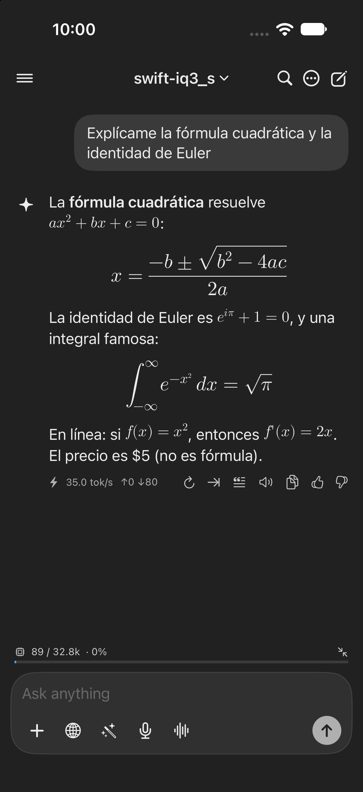
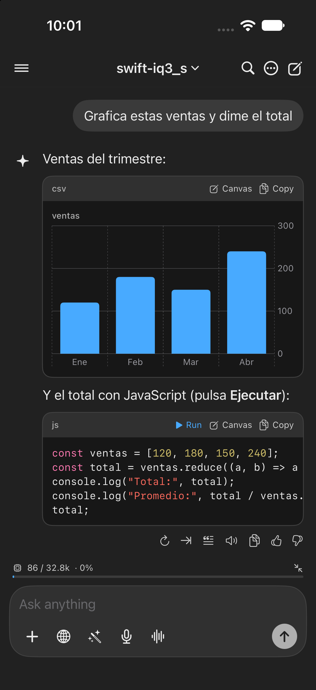
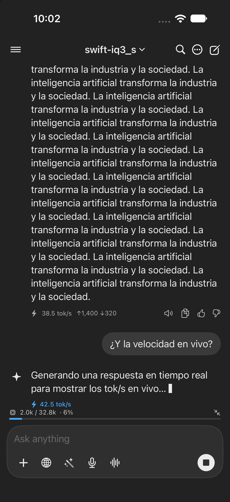
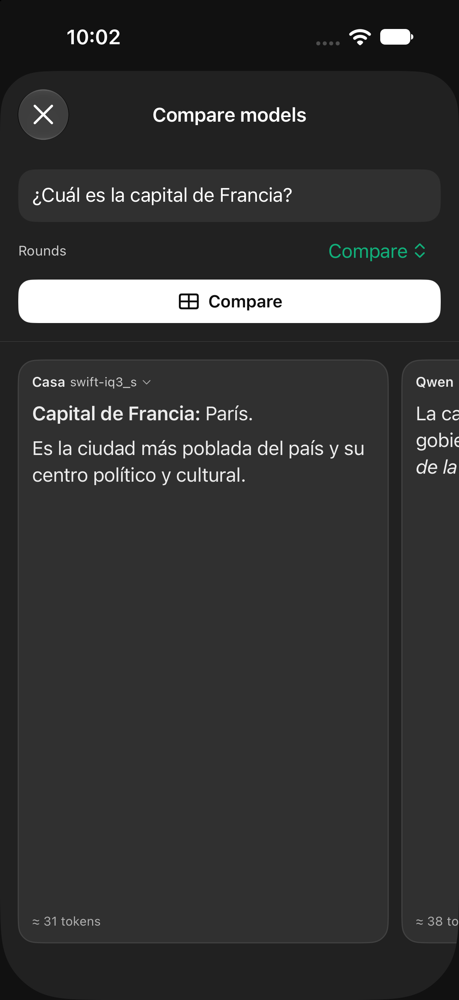
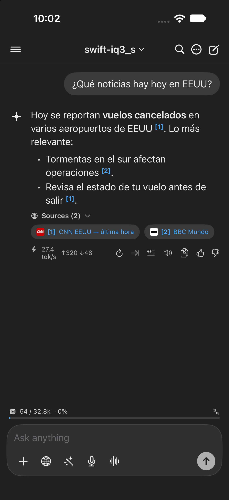
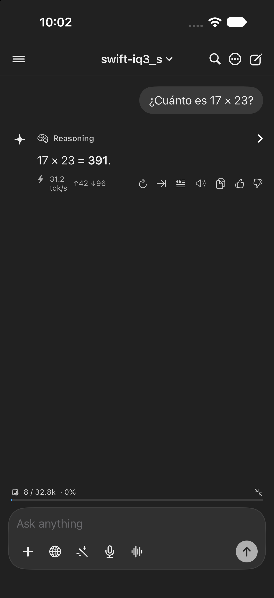
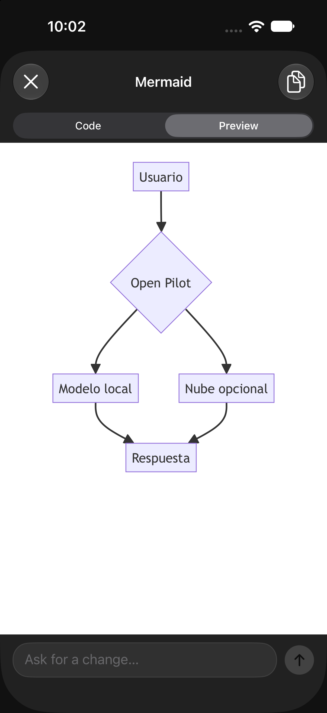
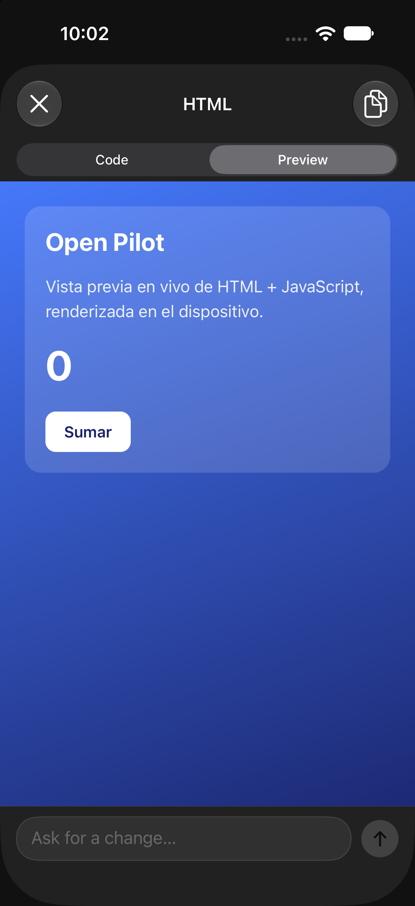
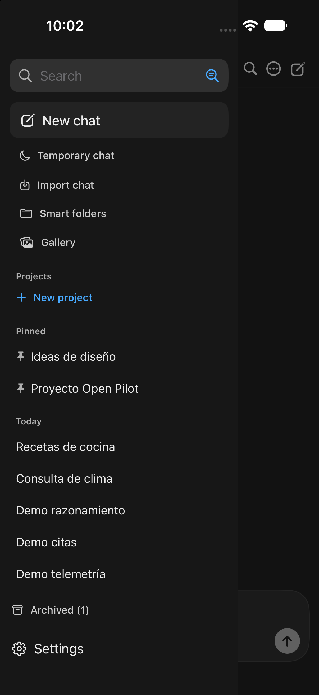
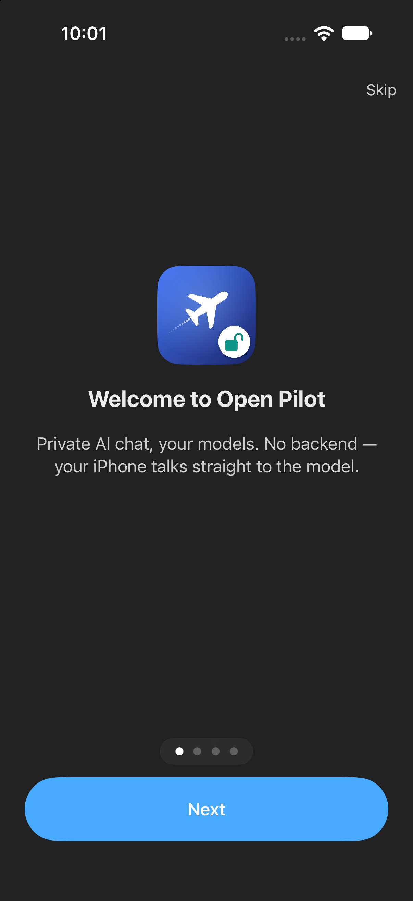

<div align="center">


# Open Pilot

**Private AI chat, your models.** A native, open-source iOS harness that talks *straight* from your iPhone to the model you choose — no backend, no account, no telemetry.

[](https://github.com/ELPilotPR/open-pilot/releases/latest)
[](LICENSE)
[](https://developer.apple.com/ios/)
[](https://swift.org)
[](https://developer.apple.com/xcode/swiftui/)
[](ios/OpenPilotTests)
[](#privacy--security)
[](#contributing)

[**Download IPA**](https://github.com/ELPilotPR/open-pilot/releases/latest) · [Features](#features) · [Screenshots](#screenshots) · [Build from source](#build-from-source) · [Privacy](#privacy--security)

</div>

---

Open Pilot is a full-featured ChatGPT-class client rebuilt **clean-room in pure SwiftUI** — and then pushed further. It streams from any OpenAI-compatible endpoint (a local model on your LAN, or a cloud API), Anthropic, Apple's on-device model, or an offline GGUF running on llama.cpp. Every conversation, setting and key lives **on your device**. There is no server in the middle, nothing to sign up for, and nothing phoning home.

What makes it more than a clone: **live tokens/sec**, a **context-window gauge** that auto-scales to your model (up to 512k+), a **reasoning panel with its own scroll**, **personas**, side-by-side **model comparison**, an on-device **code interpreter**, **Canvas** with live HTML/JS preview and offline Mermaid, **deep research**, and a genuinely private **temporary chat**.

## Screenshots

<div align="center">

| | | |
|:--:|:--:|:--:|
|  |  |  |
| **Native LaTeX math** | **Syntax-highlighted code** | **Live tok/s + context gauge** |
|  |  |  |
| **Side-by-side model comparison** | **Web search with citations** | **Visible reasoning trace** |
|  |  |  |
| **Offline Mermaid diagrams** | **Canvas live HTML/JS preview** | **Projects, pins & smart folders** |



*A friendly first-run welcome — then straight to your models.*

</div>

## Why Open Pilot

- 🔒 **Truly private.** No backend, no account, no analytics. Keys in the device **Keychain**, chats in on-device **SwiftData**. Requests go device → provider, full stop.
- 🏠 **Your models, your rules.** Point it at a self-hosted model on your network (`http://192.168.x.x:8080/v1`), any OpenAI-compatible cloud, Anthropic, Apple Intelligence, or an offline GGUF. Mix and match per chat.
- ⚡ **See the engine.** Live **tokens/sec** and token counts on every reply, plus a **context gauge** that detects/scales to the model's window (manual override up to 512k+) and **auto-compacts** old turns when you near the budget.
- 🧠 **Reasoning you can read.** Models that "think" get a collapsible trace with **its own scroll**, so you can follow the thought without losing your place in the chat.
- 🎭 **Personas.** Named response presets (built-in + your own) prepended to the system prompt — switch the assistant's voice in a tap.
- 🛠️ **A real harness, not a wrapper.** On-device code interpreter, Canvas with versions + live preview, deep research, model comparison, dictation + read-aloud — all client-side.

## Features

### Chat & models
- **Streaming chat** with a live typing cursor over any OpenAI-compatible endpoint or Anthropic.
- **Background continuation** — switch apps mid-answer and generation keeps running for iOS's background grace period instead of being cut off immediately.
- **Multiple providers & models** — add endpoints + keys in Settings, switch per chat; a **model picker** with capability presets (vision, reasoning), manual entry and server model discovery.
- **Model comparison (N-way)** — one prompt to as many models as you want, streaming side by side, each column re-pointable. Per-column **evidence**: time-to-first-token, total time, average tok/s and ↑prompt/↓completion tokens, with the fastest highlighted. **Crown a winner**, add/remove columns on the fly, and expand each column's **reasoning**. Optional multi-round **debate** (1–4).
- **Edit & resend with version branches** (`< 1/2 >`), regenerate, **Continue** a truncated answer, smart titles, 👍/👎 feedback.
- **Reply / quote threading**, per-conversation **drafts**, and an **outline** that lists your turns and jumps to any message.

### Reasoning & context
- **Visible reasoning** with a dedicated, independently-scrolling panel.
- **Live telemetry** — tokens/sec, prompt/completion token counts per message.
- **Context gauge** above the composer; window auto-detected/scaled (override up to 512k+), with a budget that defaults to ~70% of the window.
- **Automatic compaction** condenses older messages into a summary past your budget (recent turns stay verbatim); **compact now** on demand with a savings report.

### Knowledge & the web
- **Web search with inline citations** — grounded answers with tappable source pills and **citation preview cards**. **Context-aware follow-ups**: "search the same" / short follow-ups resolve against the chat topic instead of searching bare words (no more random pages); social/image boards are filtered out.
- **Web fetch → readable text** — pulls article/main content (size-capped), fully client-side.
- **Deep research** — the model plans sub-queries, the app searches and reads the web, then synthesizes a cited report.
- **Generative UI cards** — native weather and currency cards from public, key-free APIs (Open-Meteo, Frankfurter/BCE).

### Create & code
- **Rich Markdown** — headings, lists, blockquotes, tables, fenced code with on-device syntax highlighting (throttled streaming for smooth scroll).
- **Native LaTeX math** — inline `$…$` and display `$$…$$` typeset on-device (no webview, no server).
- **Canvas** — a model-assisted side editor with navigable versions; **Code / Preview** renders HTML & JavaScript in an on-device WebView and draws **Mermaid** diagrams fully offline.
- **Code interpreter** — run JavaScript in an on-device sandbox (no network/files) from a code block; render `csv` blocks as bar charts.
- **Image generation, editing & variations** (image-to-image) on providers that support it.

### Voice
- **Dictation** in English or Spanish (follows the app language; on-device recognition when available); **read replies aloud** with a pickable device voice.

### Attachments
- Photos from library or camera, plus **files** extracted into context: **PDF, .docx, .xlsx**, Markdown, code, CSV, JSON, XML, YAML, RTF and plain text — parsed on-device.

### Memory & personalization
- **Custom instructions** ("about you" + response preferences) injected into every chat.
- **Personas** — built-in and custom response presets.
- **Projects & automatic memory** — group chats with their own instructions; the app remembers facts about you across chats (editable in Settings), with an optional overnight **Dream** consolidation pass.
- **Prompt library & `/` slash commands** — reusable prompts inserted live as you type.
- **Temporary chat** — private mode with no memory and no history.

### Organize & export
- **Pin, archive, smart folders**, date-grouped sidebar, rename, and search by title or content; in-conversation search.
- **Export & import** — any chat as **Markdown**, **PDF**, or a faithful **JSON** backup (full version tree, reasoning, attachments); import JSON to restore.
- **Share extension**, **Siri & Shortcuts** (App Intents), Spotlight and Handoff. *(Extensions ship in the repo; the prebuilt IPA is core-only — see note below.)*

### Platform & polish
- **On-device model** (Apple Intelligence / FoundationModels) and **offline GGUF** (llama.cpp) providers — no server, no key.
- **English / Español** (follows device, manual override); **Automatic / Light / Dark**.
- **iPad & Mac ready** — two-column split view, keyboard shortcuts (⌘N, ⌘Return, ⌘F, ⌘B, ⌘,).
- **First-run onboarding**, haptics, and a native, fluid SwiftUI interface.
- **Activity heatmap** — a year-long, GitHub-style grid of sessions and tokens per day in the Usage dashboard; toggle the metric and tap any day for details.
- **Turn inspector** — per-reply evidence sheet: model, time-to-first-token, total time, tok/s, prompt/completion tokens, estimated cost, sources and metadata.
- **Compare presets** — save named model matchups and reload them from the bookmark menu in the comparator.
- **Conversation branching** — long-press any message and choose **Branch in new chat** to fork the active path up to that point into a fresh, independent chat; the original stays untouched.
- **Usage badges** — each chat in the sidebar shows its total tokens and estimated cost (or **Local** for on-device/LAN models), with full VoiceOver labels.
- **Full backup** — export every chat and provider setup to one portable JSON file and restore it on any device (replace or merge). API keys never leave the Keychain.

### New in 1.0.6
- **Full backup & restore** — Settings → Backup exports all chats (pins, archives, tags and the full version tree) plus provider metadata to a single JSON file; import restores with **Replace** (wipe current chats) or **Add** (merge copies). Temporary chats are excluded and API keys are never written to the file.
- **611 tests passing** (was 601).

### New in 1.0.5
- **Usage badges per chat** — the sidebar shows total tokens and estimated USD cost (or **Local**) under each conversation title, computed from the active path. Empty chats stay compact.
- **Accessibility pass** — sidebar rows expose a combined VoiceOver label (title, pinned state, tokens, cost) with an "opens the conversation" hint; the clear-search button is labelled. Text uses scalable Dynamic Type styles.
- **601 tests passing** (was 591).

### New in 1.0.4
- **Branch in new chat** — fork a conversation from any message: the active path up to that message is copied into a new chat (reasoning, telemetry, attachments and feedback preserved), leaving the original intact. Available from the long-press menu on both your messages and replies.
- **591 tests passing** (was 578).

### New in 1.0.3
- **Estimated cost per turn** — the turn inspector (ⓘ) now shows an estimated USD cost from the model's pricing, or **Local (free)** for on-device/LAN models.
- **Compare presets** — save a named matchup in the model comparator and reload it later from the bookmark menu; delete presets you no longer need. Stored locally on device.
- **Subtle completion haptic** — a gentle tap when a reply finishes streaming (respects **Settings → Feedback → Haptics**).
- **578 tests passing** (was 565).

### New in 1.0.2
- **Live voice mode removed** — the continuous hands-free listen → reply → listen loop proved unreliable, so it is gone. **Dictation (EN/ES) and read-aloud (TTS) stay**, and the Siri/Shortcuts voice intent now starts dictation.
- **Activity heatmap** — sessions/tokens per day over the last year in the Usage dashboard, with a metric toggle and per-day detail on tap.
- **Turn inspector** — tap the ⓘ on any reply for time-to-first-token, total generation time, tok/s, prompt/completion tokens, content stats and metadata; timing is captured live during streaming.
- **565 tests passing** (was 544).

### Fixes in 1.0.1
- **Web search relevance on follow-ups** — the first search in a chat worked, but later "search the same / another thing" turns searched the bare message and returned unrelated pages. Queries now resolve against the conversation topic (anaphora like "the same" reuses the prior query; short follow-ups are augmented with it), and social/image boards (Pinterest, Instagram, Facebook, TikTok, X) are filtered out.
- **Generation no longer stops when you leave the app** — a background-task assertion keeps the stream alive for iOS's background grace period and the SSE session uses extended background idle mode, so switching apps mid-answer no longer interrupts it immediately. (iOS still caps total background time; very long answers may pause once the window expires.)
- **Real context-window auto-detection** — per-model catalog plus an active server probe (the **Detect from server** button) reads the true window from OpenAI-compatible servers, including Qwen Cloud's 1M.
- **Model comparison upgraded** — columns now show time-to-first-token, total time, average tok/s and prompt/completion token counts (fastest highlighted); add/remove columns to compare N models, crown a winner, and read each model's reasoning. All on-device, no backend.
- **Dictation works in English and Spanish** — recognition follows the app language instead of a fixed Spanish recognizer and no longer fails silently when the on-device language asset is missing.

## Providers

| Provider | Endpoint | Key needed | Notes |
|---|---|:--:|---|
| **OpenAI-compatible (cloud)** | e.g. `https://dashscope.aliyuncs.com/compatible-mode/v1` (Qwen), OpenAI, Groq, Together… | ✅ | Any `/v1`-style API; add in Settings → Providers |
| **OpenAI-compatible (local)** | e.g. `http://192.168.x.x:8080/v1` (llama.cpp, LM Studio, vLLM, Ollama…) | optional | Local-network HTTP permitted |
| **Anthropic** | `https://api.anthropic.com` | ✅ | Native Messages API |
| **On-device (Apple)** | FoundationModels | ❌ | Apple Intelligence, iOS 26+ compatible device |
| **On-device (GGUF)** | llama.cpp, bundled | ❌ | Download a `.gguf` in Settings → Local Models; CPU inference |

## Getting started

### Option A — Sideload the IPA (no Xcode)

Grab `OpenPilot.ipa` from the [latest release](https://github.com/ELPilotPR/open-pilot/releases/latest) and install it with a sideloading tool using your own Apple ID:

- **[AltStore](https://altstore.io)** / **[SideStore](https://sidestore.io)** — refresh over Wi-Fi, no computer after setup.
- **[Sideloadly](https://sideloadly.io)** — desktop installer (macOS/Windows).

> The release IPA is **development-signed and core-only**: the chat app with every provider above. The Share / Keyboard / Widget extensions and Live Activities require the **App Groups** capability (an explicit provisioning profile), so they are built from source rather than included in the prebuilt IPA. Sideloading re-signs with your Apple ID; a free account works (7-day refresh) as does a paid one.

### Option B — Build from source

Requirements: macOS with **Xcode 16+** (iOS 18 SDK) and **[XcodeGen](https://github.com/yonaskolb/XcodeGen)**.

```bash
brew install xcodegen          # if you don't have it
cd ios
scripts/bootstrap-gguf.sh      # fetch the llama.cpp xcframework for offline GGUF (~178 MB)
xcodegen generate              # creates OpenPilot.xcodeproj from project.yml
open OpenPilot.xcodeproj
```

Select your signing team and run on a simulator or device. On first launch, open **Settings → Providers**, add an endpoint (your local model or a cloud API) and paste your key. That's it.

> The Xcode project is generated from `ios/project.yml` and intentionally not committed. A **core-only** spec (`project-core.yml` → `OpenPilotCore.xcodeproj`) builds the app without App Group entitlements — handy for installing with a wildcard provisioning profile. The offline GGUF provider links the prebuilt `llama.xcframework` (gitignored, ~568 MB extracted); `scripts/bootstrap-gguf.sh` downloads and checksum-verifies it once.

## Architecture

Pure **SwiftUI + SwiftData**, no third-party UI dependencies, no backend. The device is the client: providers are plain HTTP/SSE (or on-device inference), and every helper that can be tested is a pure, isolated function.

```
ios/
  project.yml            XcodeGen spec — source of truth for the Xcode project
  project-core.yml       Core-only spec (no App Groups) for wildcard signing
  OpenPilot/
    Models/              SwiftData models (Conversation, Message, ProviderConfig…)
    Providers/           OpenAI-compatible, Anthropic, FoundationModels, GGUF (llama.cpp)
    Services/            streaming, context/compaction, web search, memory, personas,
                         office parsing, export/import, voice, code interpreter…
    ViewModels/          chat orchestration
    Views/               SwiftUI screens (chat, canvas, compare, settings, onboarding…)
    Resources/           bundled mermaid.js (offline diagrams)
  OpenPilotTests/        XCTest suite (611 tests)
  ShareExtension/  WidgetExtension/  KeyboardExtension/   (App Group capabilities)
docs/                    feature inventory, privacy policy, screenshots
```

## Privacy & security

Open Pilot has **no backend**. Requests go straight from your device to the provider you configure. Conversations are stored locally (SwiftData) and API keys are kept in the device **Keychain** — never in plaintext, never sent anywhere else. The app permits local-network HTTP so you can reach a self-hosted model. The code interpreter runs in a sandbox with **no network or file access**. Web features call public APIs directly from the device.

Read the full [privacy policy](https://elpilotpr.github.io/open-pilot/privacy-policy.html).

## Testing

An **XCTest suite (611 tests)** covers the version tree, model catalog, custom instructions, file/office parsing, citations, Canvas helpers, projects, memory, personas, feedback, temporary chat, in-conversation search, LaTeX parsing, export/import round-trips, prompt slash matching, JavaScript sandbox execution, CSV parsing, context compaction & budgeting, Canvas preview building, model-comparison logic & metrics (time-to-first-token, tok/s, tokens), N-way columns and winner selection, the chat outline, voice selection/barge-in logic, and web-search query cleaning & relevance ranking, and context-aware follow-up search queries.

```bash
cd ios
xcodegen generate
xcodebuild test -project OpenPilot.xcodeproj -scheme OpenPilot \
  -destination 'platform=iOS Simulator,name=iPhone 16'
```

## Roadmap

- [x] Streaming, Markdown/tables + syntax highlighting, native LaTeX, web citations, GenUI cards, images, voice, attachments
- [x] Reasoning panel, live tok/s + context gauge, auto-compaction & budgeting
- [x] Edit/resend version branches, Continue, drafts, quote threading, outline / jump-to-message
- [x] Export (Markdown/PDF/JSON) & import, rename, conversation search, pin/archive/smart folders
- [x] Canvas (versions) + live HTML/JS preview + offline Mermaid; on-device code interpreter + CSV charts
- [x] Side-by-side model comparison; deep research; image editing & variations
- [x] Personas, custom instructions, projects + automatic memory (+ Dream), prompt library / slash commands
- [x] Voice picker + barge-in; dictation (EN/ES) + read replies aloud
- [x] On-device model (FoundationModels) + offline GGUF (llama.cpp)
- [x] Office attachments (.docx/.xlsx), first-run onboarding, i18n (EN/ES), Light/Dark, Keychain keys
- [x] Share extension, Siri & Shortcuts, iPad/Mac split view + shortcuts, automated XCTest suite
- [ ] Windows / Android / desktop clients (monorepo-ready)

## Contributing

Issues and PRs are welcome. Please keep the **no-backend, on-device-first** principle: new features should run client-side and respect the Keychain/SwiftData privacy model. Run the XCTest suite before submitting.

## License

[MIT](LICENSE) © Open Pilot contributors.